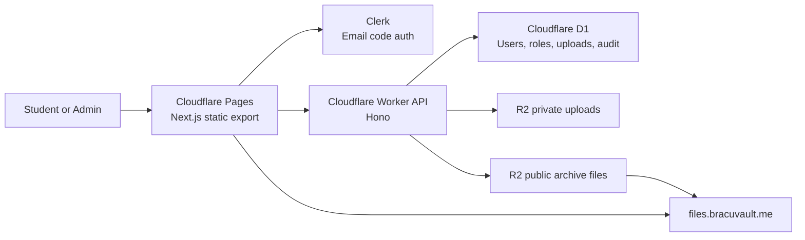

# BRACU Vault

BRACU Vault is a production-grade academic resource platform I built for BRAC University CSE students. It brings course notes, slides, lab resources, past questions, projects, verified student uploads, file previews, search, and admin moderation into one deployed web product.

Live site: [bracuvault.me](https://bracuvault.me)

Built by **Imtiaz Hossain**.

> BRACU Vault is an unofficial, student-run project. It is not affiliated with, endorsed by, or operated by BRAC University.

## Product Overview

BRACU students often rely on scattered drive links, old group posts, and repeated requests for course materials. I built BRACU Vault as a centralized, searchable archive where students can browse resources by course, preview files, contribute new material, and keep the collection clean through moderation.

The project is live, uses real cloud infrastructure, and includes both public student-facing workflows and private admin workflows.

## Core Features

- Course-based archive for BRAC University CSE resources.
- Searchable catalog of notes, slides, labs, past questions, and projects.
- Per-course pages with structured folders and file previews.
- Student sign-in through Clerk using university email verification.
- Contextual uploads from inside course folders.
- Moderation queue before community uploads become public.
- Admin dashboard for uploads, users, roles, audit logs, and file overrides.
- Role-based access control for students, moderators, admins, and super admins.
- Public R2 file delivery with separate private upload storage.
- SEO-ready pages with sitemap, robots rules, canonical URLs, and JSON-LD.
- Static frontend deployed globally on Cloudflare Pages.
- Edge API deployed on Cloudflare Workers.

## Engineering Highlights

- Built as a real deployed full-stack product, not a demo scaffold.
- Cloudflare-native architecture with Pages, Workers, D1, and R2.
- Clean API layering: controllers, services, repositories, policies, middleware.
- Data-driven RBAC instead of hardcoded admin checks.
- D1 migrations for uploads, contextual sections, and file overrides.
- Runtime merge of static archive files and approved community uploads.
- Admin file override system for hiding, renaming, and re-filing static archive items without rebuilding the whole catalog.
- Upload quota and duplicate-upload protection.
- Static export frontend with dynamic client-side catalog behavior.
- GitHub Actions CI for API type checking and frontend production builds.

## Tech Stack

| Layer | Technology |
| --- | --- |
| Frontend | Next.js 14 App Router, React, TypeScript, Tailwind CSS, Framer Motion |
| Auth | Clerk, email verification code, BRAC University GSuite allowlist |
| API | Cloudflare Worker, Hono, TypeScript |
| Database | Cloudflare D1, SQLite, Drizzle ORM |
| Storage | Cloudflare R2 private uploads bucket and public files bucket |
| Hosting | Cloudflare Pages, Workers custom domain, R2 public custom domain |
| Tooling | Wrangler, GitHub Actions, npm |

## Architecture



## Repository Layout

```text
.
|-- landing/      Next.js frontend, archive UI, course pages, admin UI
|-- api/          Cloudflare Worker API, D1 schema, migrations, services
|-- docs/         Architecture, deployment, and SEO notes
`-- .github/      CI, issue templates, and PR template
```

## Local Development

Requirements:

- Node.js 20 or newer
- npm
- Cloudflare account for D1/R2 deployment
- Clerk app for authentication

Install dependencies:

```bash
npm --prefix api ci
npm --prefix landing ci
```

Create local environment files:

```bash
copy api\.dev.vars.example api\.dev.vars
copy landing\.env.example landing\.env.local
```

Run the API and frontend in separate terminals:

```bash
npm run dev:api
npm run dev:landing
```

Default local URLs:

- Frontend: `http://localhost:3000`
- API: `http://localhost:8787/api/v1/health`

## Validation

```bash
npm run check
```

This runs:

- API TypeScript check
- Landing production build

## Deployment

Production currently runs on:

- Site: `https://bracuvault.me`
- API: `https://api.bracuvault.me`
- Files: `https://files.bracuvault.me`

Deployment notes are in [docs/DEPLOYMENT.md](docs/DEPLOYMENT.md).

## Environment Files

Do not commit real secrets.

- `api/.dev.vars.example` documents Worker local secrets.
- `landing/.env.example` documents frontend public environment variables.
- Production secrets should be configured through Cloudflare and Clerk dashboards or `wrangler secret put`.

