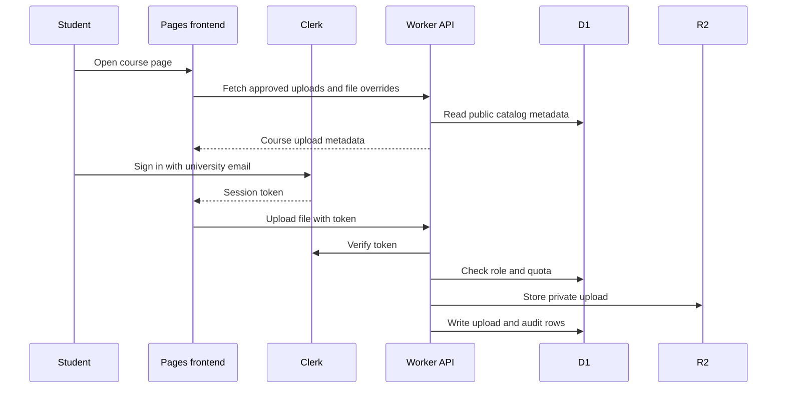

# Architecture

BRACU Vault is split into a static frontend and an edge API.

## Components

| Component | Role |
| --- | --- |
| `landing/` | Next.js App Router static export deployed to Cloudflare Pages |
| `api/` | Cloudflare Worker API built with Hono |
| Cloudflare D1 | Relational data for users, roles, uploads, overrides, and audit logs |
| Cloudflare R2 private bucket | Raw student uploads before moderation |
| Cloudflare R2 public bucket | Approved files and static archive files |
| Clerk | Identity, sessions, and email code sign-in |

## Request Flow



## Verification Model

The current gate is email-only:

1. Clerk verifies that the user owns an email address.
2. Clerk allowlist restricts sign-up to `@g.bracu.ac.bd`.
3. The Worker activates the user and grants `verified_student`.

The roster import exists for future features, but it is not part of the current access gate.

## RBAC

Roles are stored in D1 and permissions are data-driven.

Role ladder:

```text
unverified < pending < verified_student < moderator < admin < super_admin
```

Controllers parse and authorize requests, services handle business logic, repositories handle Drizzle/D1 access.

## Upload Publishing

1. Student uploads a file from a course folder.
2. Worker stores the file in the private uploads bucket.
3. Admin or moderator approves the upload.
4. Worker copies the file to the public files bucket.
5. Course pages merge approved community files at runtime.

## File Overrides

Static archive files cannot be edited in-place without a rebuild. Admin overrides solve that by storing hide, rename, and re-file metadata in D1. The frontend applies overrides to course browsing and command search at runtime.

